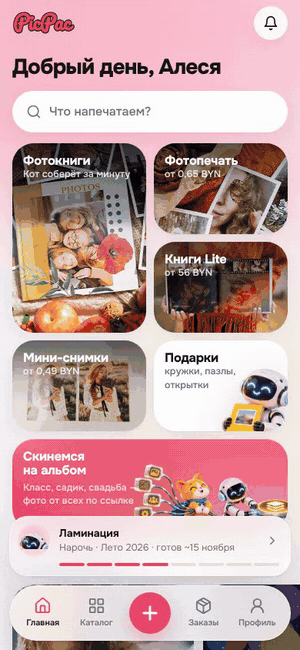
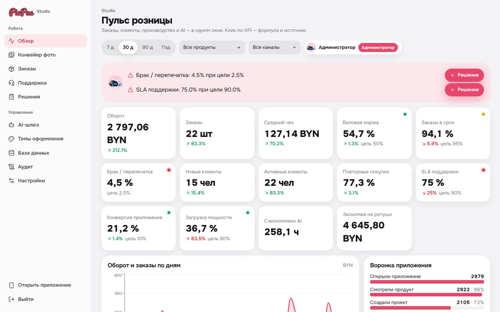

# picPac — photo products app for a print studio

**Great Stone hackathon (Velikiy Kamen), track 2, case from Fotoprint / picPac.by.** A mobile app (PWA) for ordering photo prints, photo books, graduation albums, cards, calendars and mugs, plus the **Studio** admin panel with analytics, a photo pipeline and an AI gateway.

The idea: picPac is a director, not an editor. **The Cat** (creative director) picks the best shots and builds the layout by itself, **the Robot** (quality control) checks every page before printing. All advice is optional — the order is blocked only by an empty frame.

<table>
<tr>
<td width="34%" valign="top" align="center"></td>
<td valign="top">
<p><b>In the demo:</b> catalog → photo book with a 3D preview → pick photos → the Cat builds the book in 0.1 s → editor → the Robot's pre-print check with optional fixes.</p>
<ul>
<li><b>Backend:</b> FastAPI, SQLAlchemy, JWT auth with client / manager / admin roles, idempotent orders, offline autosave with versions</li>
<li><b>Image AI on CPU:</b> YuNet face detection ("faces must not fall under the trim"), FSRCNN ×2/×4 upscaling, U²-Net background removal, duplicate and blur detection, auto layout</li>
<li><b>LLM assistant:</b> Qwen3 through Ollama or any OpenAI-compatible API, with a built-in fallback so the app keeps working</li>
<li><b>Voice commands</b> over WebSocket (Vosk), Telegram order status bot</li>
<li><b>Frontend:</b> React, TypeScript, Vite, three.js 3D book preview, configurable themes</li>
<li>Everything runs with <code>docker compose up</code></li>
</ul>
</td>
</tr>
</table>

**Studio** — KPI dashboard with formulas, production forecast vs capacity, photo pipeline, orders, support with AI drafts, AI gateway, themes, Django-style database admin and audit log.



---

# picPac — фото на бумаге, кружках и в книгах

**Трек 2 хакатона «Великий камень» · ООО «Фотопринт».** Мобильное приложение picPac.by (PWA → Android/iOS) для фотоцентра:
фотопечать, фотокниги, выпускные альбомы, открытки, календари, кружки, пазлы, постеры. Плюс админка Studio с аналитикой (мост к треку 1),
конвейером фото и AI-шлюзом.

> **Идея: picPac — не редактор, а режиссёр.** Кот (креативный директор) сам отбирает кадры и собирает макет,
> Робот (ОТК) проверяет печать и советует улучшения. **Все советы необязательны** — клиент может принять или оставить как есть.
> «Скинемся на альбом» — общий альбом класса или свадьбы по ссылке.

## Запуск

```bash
docker compose up -d --build                         # приложение + API → http://localhost:8080
docker compose --profile local-ai up -d ollama       # (необязательно) локальная Qwen3 на этом же ПК
docker compose exec ollama ollama pull qwen3:1.7b
```

| Роль | Почта | Пароль | Что видит |
|---|---|---|---|
| Клиент | `client@picpac.test` | `demo1234` | приложение (фото, черновик, заказ в производстве) |
| Менеджер | `operator@picpac.test` | `operator1234` | Studio: обзор, конвейер фото, заказы, поддержка, решения |
| Администратор | `admin@picpac.test` | `admin1234` | всё + AI-шлюз, темы, база данных, аудит, настройки |

**С телефона:** телефон и ПК в одной Wi-Fi сети → откройте `http://<IP ПК>:8080`. Если не открывается — разрешите входящие
подключения в брандмауэре Windows для Docker и включите «Local network sharing» в VPN (Mullvad и т. п.).
Для HTTPS-ссылки (установка PWA, микрофон) можно запустить `cloudflared tunnel --url http://localhost:8080`.
**Разработка:** `uvicorn app.main:app --app-dir backend --port 8000` и `cd frontend && npm run dev` (Vite на `0.0.0.0:5173`).

## Дизайн-система
- Шрифт **Onest** (одна гарнитура), плотные жирные заголовки, крупные скругления, стекло (`backdrop-filter`) и «живой» градиентный фон.
- Референс — продукты Яндекс Go/Еда: плитки сервисов с живыми мокапами товаров из фото пользователя, поиск-пилюля, док-таббар.
- **Темы — конфигурируемые**: `backend/app/config_data/themes.json` (Роза и Солнечная, светлые и тёмные). Админ создаёт свои темы
  в Studio → «Темы оформления»: один цвет → генератор строит палитру, проверка контраста, живое превью. Все оттенки — `color-mix`
  от токенов, в коде нет захардкоженных цветов. Клиент выбирает тему в профиле, админ задаёт тему по умолчанию.
- Маскоты — 3D-персонажи из презентации «Фотопринта», вырезаны нейросетью (rembg/IS-Net) и увеличены нашей FSRCNN.

## Каталог и шаблоны
- `config_data/catalog.json` — 20 товаров в 6 категориях (по ассортименту picpac.by + сувенирка): фотопечать классическая и мини-снимки;
  фотокниги Lite/Classic/Premium; выпускные альбомы (сад, 4 класс, 9/11 класс); открытки, приглашения, фотоконверты; календари;
  кружки, магниты, пазлы, подушки, футболки; постеры и холсты. Цены и активность меняются в Studio.
- `config_data/templates.json` — 21 дизайн-шаблон (свадьба, малыш, путешествия, Новый год, выпускной, крещение, осень, скрапбук…):
  фон страницы, шрифт подписей, рамки, декор.

## Нейросети и AI
| Задача | Модель | Где работает |
|---|---|---|
| Поиск лиц, «слежка за обрезом», портретная ретушь | **YuNet** (OpenCV Zoo) | CPU, ONNX |
| Увеличение разрешения ×2/×4 | **FSRCNN** (dnn_superres) | CPU |
| Удаление фона | **U²-Net-p** (onnxruntime) | CPU |
| Отбор дублей, резкость, экспозиция, автомакет | dHash, лапласиан, OpenCV | CPU |
| Кот-ассистент, подписи, черновики поддержки | **Qwen3 1.7B** (Ollama) или любой OpenAI-совместимый API | свой сервер / облако |

Каждый инструмент переключается в Studio → «AI-шлюз» (провайдер, модель, вкл/выкл, фолбэк). Если внешняя модель недоступна —
встроенный движок, работа не останавливается. Ключи хранятся на сервере, в интерфейсе — маска. Модели скачивает
`backend/scripts/download_models.py` (≈5 МБ).

**Слежка за обрезом:** каждая рамка кадрируется так, чтобы лица были целиком; Робот предупреждает «Лицо попадает под обрез»
и предлагает «Лица в кадр».

## Конвейер фото (Studio → «Конвейер фото»)
Каждый снимок: загрузка → анализ (резкость, экспозиция, лица с рамками) → советы Кота/Робота → решение клиента
(принял / оставил как есть) → AI-версии (оригинал сохраняется) → флаги проверки → заказ. Журнал `photo_events`, воронка этапов,
статистика принятия советов по типам. Справочник ситуаций — на той же странице.

## Studio (админка)
- **Обзор** — 14 KPI с формулой и источником, фильтры, воронка, производство, прогноз на 4 недели против мощности, свежесть данных.
- **База данных** — универсальная админка моделей как в Django: группы, списки с поиском и пагинацией, формы по типам полей,
  создание/удаление; пароли и ключи скрыты, журналы только для чтения.
- Заказы и модерация, поддержка с AI-черновиками, реестр решений, аудит, настройки.
- Роли: **менеджер** — операционная работа; **администратор** — плюс AI, темы, база данных, аудит. Проверка прав — на сервере.

## Обязательный путь ТЗ
Вход/гость → каталог из API → проект (загрузка, порядок, кадрирование, автомакет) → автосохранение (офлайн + версии) →
проверка (советы необязательны, блокирует только пустая рамка) → корзина (доставка, промокод, пересчёт) → тестовый заказ
(идемпотентный) → статусы → история и поддержка по заказу. Тесты: `docker compose run --rm -e DATA_DIR=/tmp/t api python -m pytest -q tests`.

## Лицензии
FastAPI, Starlette, Pydantic, Uvicorn, httpx, SQLAlchemy, PyJWT — MIT/BSD; Pillow — HPND; NumPy — BSD; OpenCV contrib, onnxruntime — Apache-2.0/MIT;
YuNet — MIT; FSRCNN (Saafke) — MIT; U²-Net — Apache-2.0; Qwen3 — Apache-2.0; React, framer-motion, Vite, dnd-kit, idb-keyval — MIT;
Recharts — MIT; lucide — ISC; шрифты Onest, Caveat, Pacifico — SIL OFL 1.1. Персонажи и бренд — ООО «Фотопринт».
